# What is this?

We started the Year of Final Fantasy as something to do with friends and community, and while I've made a lot of decisions on my own, I've tried to let the interested people in the community guide us along the way. While we have this all documented on Discord in the Year of Final Fantasy thread, I thought we should include it here too.

## Decision 1 - Play Alternate Versions of the Same Game Later

Many Final Fantasies have multiple versions. From the multitude of Final Fantasy 1 ports to FF12 having at least 3 different versions, to ones that have 'enhanced' ports like Final Fantasy 3 and 4 where there's a 3D and 2D version both available... Do we want to play multiple versions back to back, or do we want to loop around?

The community decided to **loop around**.

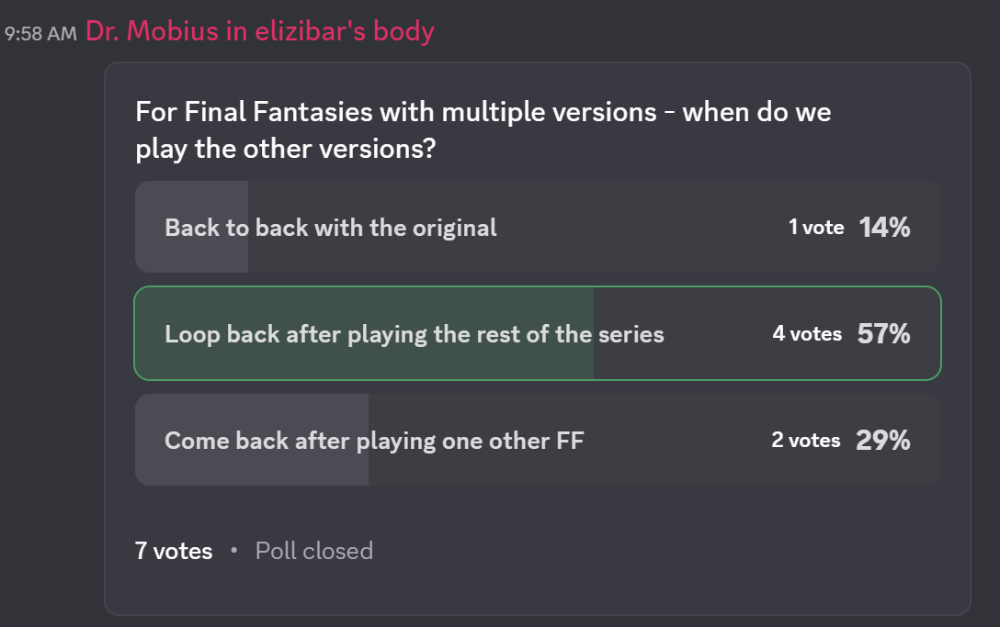{:width="30%" style="display: block; margin: 20px auto; border: 1px solid #ddd; border-radius: 8px;"}

## Decision 2 - SaGa and Secret of Mana Don't Count as Final Fantasy

Back in the day, other series of games were branded as Final Fantasy. Do they count as Final Fantasy games?

The community decided they **do not count**.

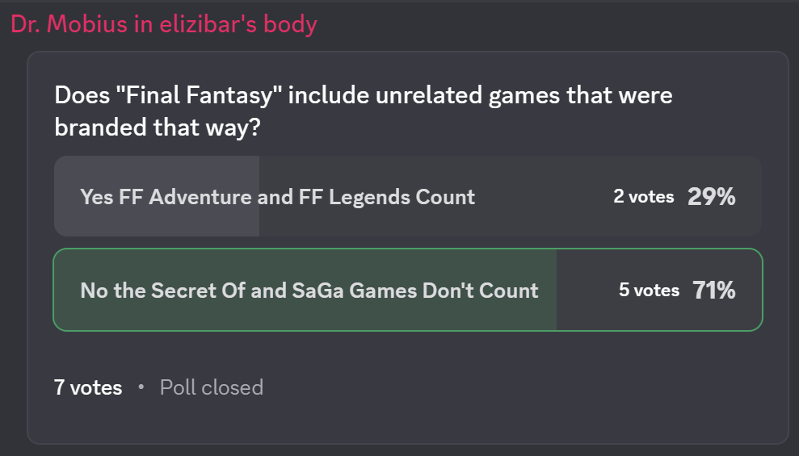{:width="30%" style="display: block; margin: 20px auto; border: 1px solid #ddd; border-radius: 8px;"}
 
## Decision 3  - Play the 3D Remaster of FF3 First

The community decided that we should play the **3D Remaster** of Final Fantasy 3 first.

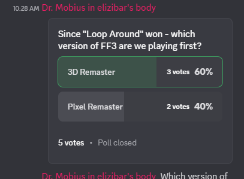{:width="30%" style="display: block; margin: 20px auto; border: 1px solid #ddd; border-radius: 8px;"}

## Decision 4 - Vagrant Story counts as a Final Fantasy game

With the connections between Vagrant Story and Ivalice, does it count as a final fantasy game?

The community decided that Vagrant Story **does count**.

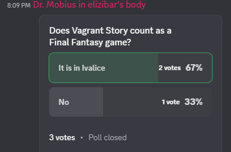{:width="30%" style="display: block; margin: 20px auto; border: 1px solid #ddd; border-radius: 8px;"}

## Decision 5 - Order of operations in FF3?

The community **could not** decide if we should defeat the optional super boss or beat the game, and then loop around to do the other one after. 

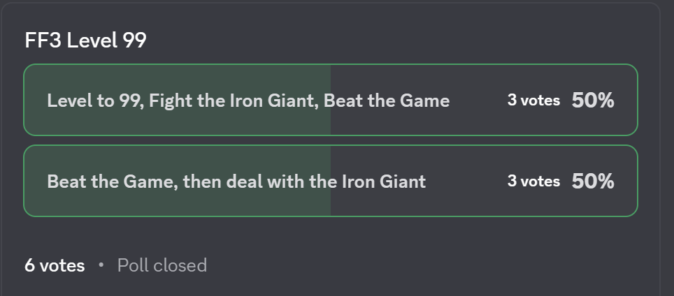{:width="30%" style="display: block; margin: 20px auto; border: 1px solid #ddd; border-radius: 8px;"}

## Decision 6 - Play the FF4 Pixel Remaster

The community decided to play the **Final Fantasy 4 Pixel Remaster** first.

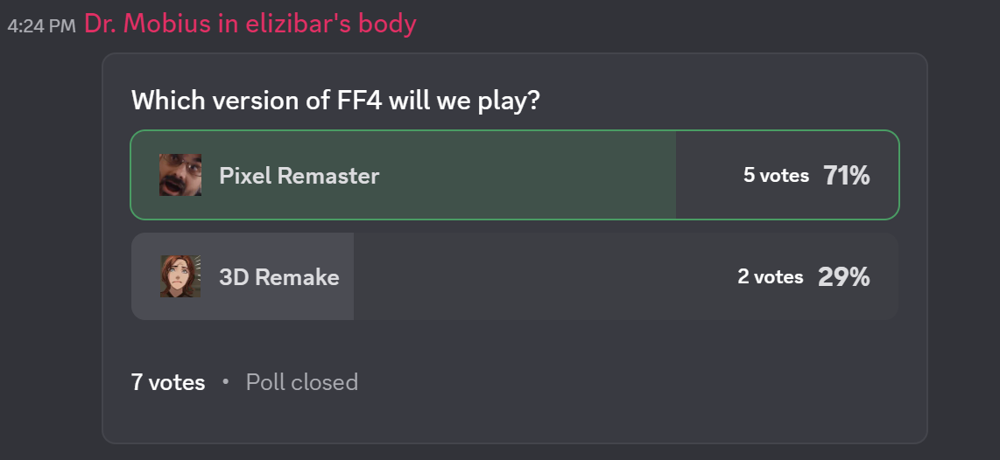{:width="30%" style="display: block; margin: 20px auto; border: 1px solid #ddd; border-radius: 8px;"}

## Decision 7 - Play The After Years First

The community decided to play **Final Fantasy 4: The After Years** instead of moving on to the next mainline game. This means we'll try to play side-games / spin-offs before moving ahead in the series.

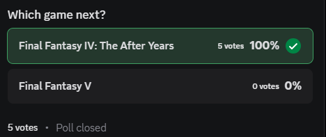{:width="30%" style="display: block; margin: 20px auto; border: 1px solid #ddd; border-radius: 8px;"}

## Decision 8 - Don't Grind Dumb Cheevos on Stream

The community decided that we **shouldn't** bother with dumb achievements on stream.

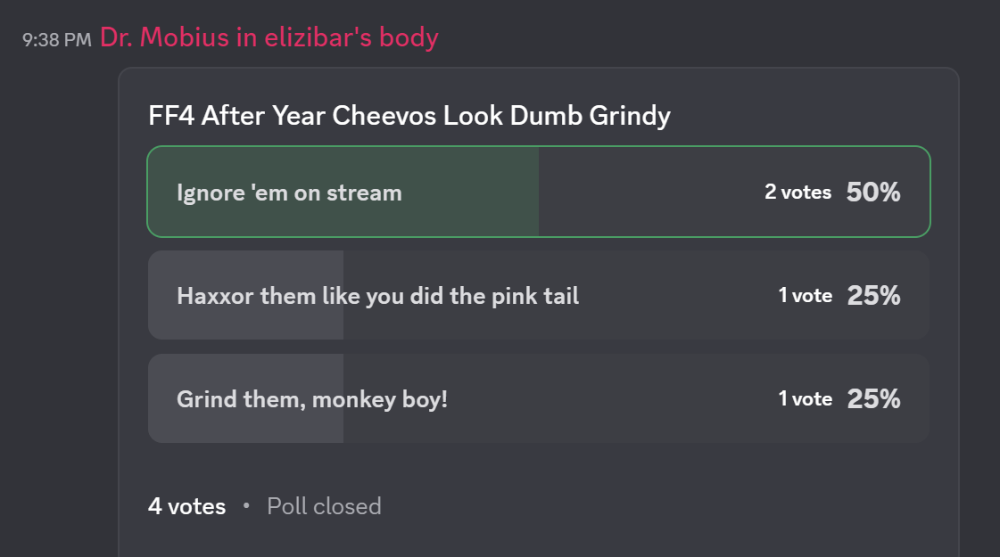{:width="30%" style="display: block; margin: 20px auto; border: 1px solid #ddd; border-radius: 8px;"}

## Decision 9 - Use tools to avoid stupid stuff

We were too nice to people, and missed the Barret Bromance scene that we were aiming for. The community decided **that was dumb**, and much like we did in FF4 to streamline some of the grind, we used a tool to fix this.

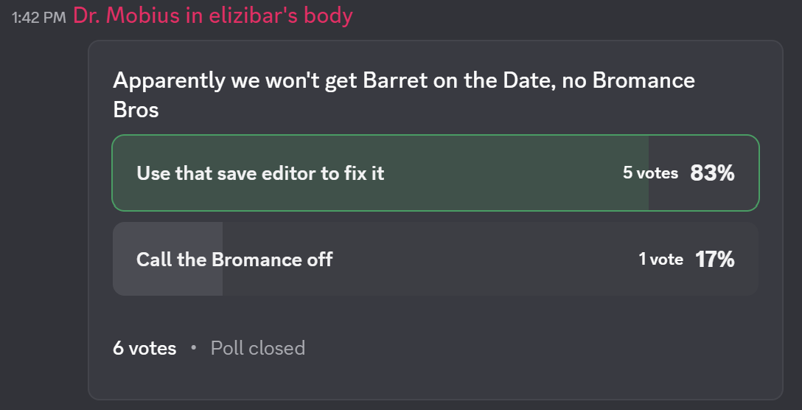{:width="30%" style="display: block; margin: 20px auto; border: 1px solid #ddd; border-radius: 8px;"}

## Decision 10 and 11 - Fight Silly Bosses in Silly Ways

The community decided I should fight the FF7 superbosses in **silly ways**.

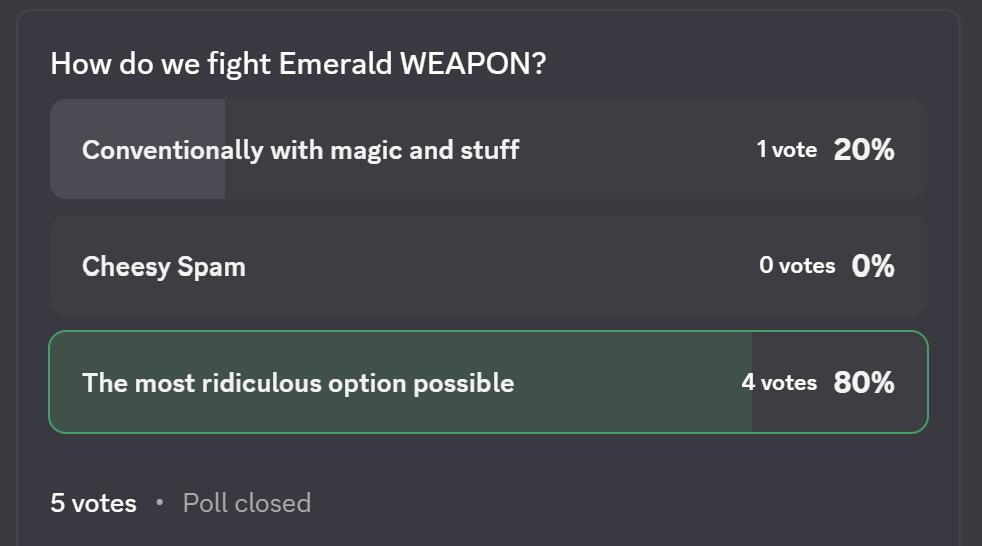{:width="30%" style="display: block; margin: 20px auto; border: 1px solid #ddd; border-radius: 8px;"}

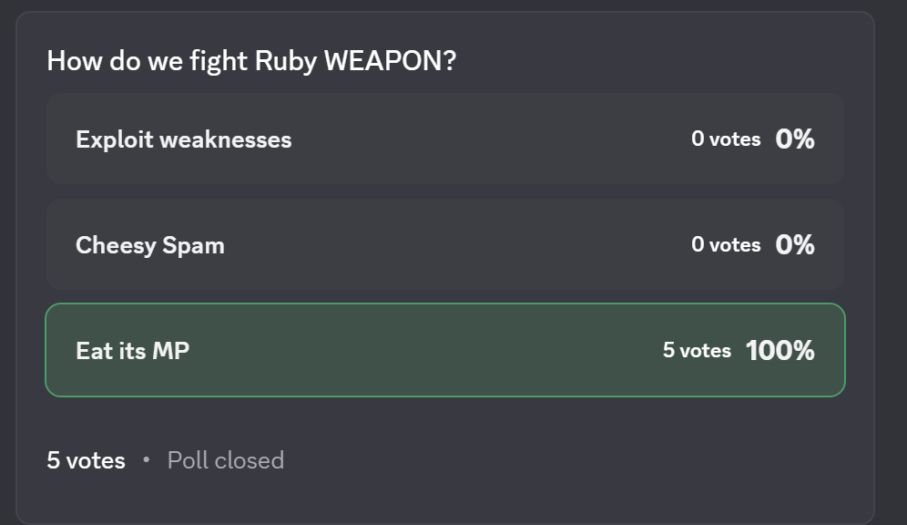{:width="30%" style="display: block; margin: 20px auto; border: 1px solid #ddd; border-radius: 8px;"}

## Decision 12 - Moot Point about FF7 game ordeer

The community decided I'd play **Before Crisis**, but then the Ever Crisis shutdown hit and we had to grind that game.

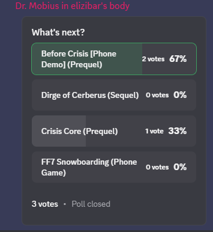{:width="30%" style="display: block; margin: 20px auto; border: 1px solid #ddd; border-radius: 8px;"}

## Decision 13 - Play Dirge of Cerberus after Ever Crisis

The community decided we would **Dirge the Cerberus** next.

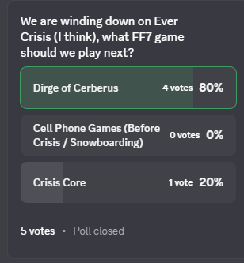{:width="30%" style="display: block; margin: 20px auto; border: 1px solid #ddd; border-radius: 8px;"}

[Return to the Year of Final Fantasy](/yearoffinalfantasy/)